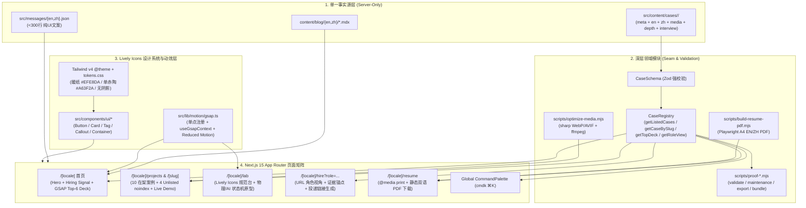
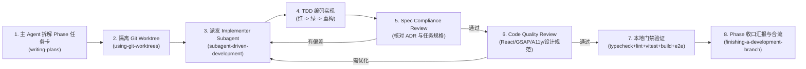

# LewisPortfolio V3 重型大规模开发规划与工作流

> **执行协议**：本规划结合已安装的全局 Skills 编制，执行阶段遵循 `using-git-worktrees`（隔离开发）+ `subagent-driven-development`（任务分治与两阶段 Review）+ `test-driven-development` + `verification-before-completion`。待审阅确认后，按 Phase 0 → Phase 4 逐步落盘并可同步保存至目标仓库 `docs/plans/2026-11-21-v3-master-plan.md`。

**Goal:** 在 48 小时内先将 `redesign/hybrid-lively` 止血上线，随后将 `LewisPortfolio` 重铸为基于 **Next.js 15 + React 19 + Tailwind CSS v4 + GSAP + Unified Case Registry** 的旗舰级双语交互作品集，纳入 `walkie` 与 `fencepost` 形成 10 案例真实证据矩阵，重造 `/lab` 交互工作台并构建角色化招聘转化引擎与生产级自动化门禁。

**Architecture:** 采用「双轨分期融合路线（路线 C）」。以 `src/content/cases/<slug>/` + `Zod` 作为唯一案例事实源（Single Source of Truth），彻底消除数据五轨撕裂与全局 i18n JSON 客户端序列化膨胀；用 Tailwind v4 `@theme` 分层重构 5,138 行 `globals.css` 严格落实 Lively Icons 暖纸规范；以 GSAP + 原生 CSS 统一动效层并移除 `framer-motion` 根治 RSC Dev 崩溃；以 `cmdk` 统一 ⌘K 命令面板并以 URL Query 驱动 `/hire` 角色视角与构建期双语 PDF 简历交付。

**Tech Stack:** `Next.js 15` · `React 19` · `TypeScript 5.7+ (strict)` · `Tailwind CSS v4` · `next-intl` · `Zod` · `GSAP 3.15` · `cmdk` · `ESLint 9 (Flat Config)` · `Vitest` · `Playwright` · `@axe-core/playwright` · `sharp` / `ffmpeg` · `pnpm 9+`

---

## 一、三轮技术对齐决策锁单表（ADR 摘要）

| 编号 | 决策域 | 已锁定方案 | 核心工程收益 |
|---|---|---|---|
| **ADR-01** | 总体战略 | **路线 C：双轨分期融合**（Phase 0 止血发布 → Phase 1-2 V3 架构重铸 → Phase 3-4 Flagship 跃升） | 兼顾毕业求职窗口期立即展示最新成果与长期可维护性 |
| **ADR-02** | 分支与主域名 | `redesign/hybrid-lively` 合入 `master` 立即发布；修正 `site.ts` 默认域名为 `https://portfolio-lewisdong.vercel.app`；归档清理 3 条旧分支 | 消除线上与开发分支 2 个月漂移，修复 canonical/hreflang/JSON-LD 错配 |
| **ADR-03** | 核心框架栈 | 升级至 **Next.js 15 + React 19 + Tailwind CSS v4 + ESLint 9** | 对齐最新稳定生态，`@theme` 原生承载暖纸色 token，显著瘦身 CSS |
| **ADR-04** | 案例事实源 | **纯 TypeScript 模块化 Schema**（`src/content/cases/<slug>/` + `Zod` 校验） | 消除 6 文件撕裂，零运行时成本，无缝兼容现有 `proof:*` 校验链 |
| **ADR-05** | i18n 分离 | 案例双语正文迁出 `messages/*.json`（仅 Server Component 按需读取），UI 字典瘦身至 `<300` 行 | 解决全站客户端 HTML 序列化 1,499 行 JSON 的严重性能浪费 |
| **ADR-06** | CSS 与设计系统 | **Tailwind CSS v4 `@theme` + 分层 CSS + 原语组件**，拆解 5,138 行 `globals.css` | 100% 统一 Lively Icons 暖纸、无阴影无模糊、单赤陶强调色规则 |
| **ADR-07** | 动效体系 | **GSAP + 原生 CSS Transitions**，移除 `framer-motion` | 避开 React 19 + framer-motion v11 兼容风险，减小首屏 JS，根治 `FeaturedDeck` Dev 崩溃 |
| **ADR-08** | `/lab` 定位 | 重造为 **Lively Icons 设计系统交互文档 + 物理/AI 状态机微原型工作台** | 消除旧版玻璃拟态视觉违和，把 `/lab` 变成 Design Engineer 实力展示场 |
| **ADR-09** | 搜索与媒体 | **`cmdk` 统一 ⌘K 命令面板**（搜案例/博客 + 切主题/语言 + 直达岗位视角），移除重复 `SearchModal`；引入 `sharp` / `ffmpeg` 压缩管线 | 提升高频交互质感；将 `public/projects/maze/` 从 `10.44 MB` 压至 `<2.5 MB` |
| **ADR-10** | 招聘与简历 | `/hire?role=product\|interaction\|design-eng\|ai-ux` URL 参数驱动角色视角 + 构建期自动生成 EN/ZH A4 静态 PDF 简历 | 支持按岗位生成专属投递链接，简历 PDF 与网页永不脱节 |
| **ADR-11** | 内容与人设 | 双轨兼顾（交互/产品设计 + 工程落地）；诚信审计上架 **`walkie`** 与 **`fencepost`** 至 **10 个在架案例**，首页 Deck 精选 **Top 6** | 强化「硬件 + AI Agent + 产品设计」差异化护城河，保持首页聚焦 |
| **ADR-12** | 质量门禁 | 生产级严格 CI：`tsc --noEmit` + `eslint` + 全量 `vitest` + `proof/content:validate` + `build` + Playwright 双语 E2E + `@axe-core/playwright` + Bundle 预算 | 堵住当前 CI 漏跑 18+ 单测与 PR 无门禁的工程盲区 |
| **ADR-13** | 协作工作流 | **Subagent-Driven 分治模式**（主 Agent 控契约与两阶段 Review + Worktree 隔离） | 上下文干净、质量稳定、Token 消耗可控 |

---

## 二、架构深化机会诊断（基于 `improve-codebase-architecture`）

当前代码库存在 5 个典型的「浅层/撕裂模块」摩擦点，V3 重构将通过**深化模块（Deep Modules）**和明确 **Seam（接缝）** 集中复杂度、提升局部性（Locality）：

| 编号 | 现有痛点模块 | 问题本质（Deletion Test 分析） | V3 深化重构方案 |
|---|---|---|---|
| **D1** | `src/components/` 顶层 40+ 文件与子目录双份并存（62 个死文件） | 历史目录迁移未删旧文件，导致 AI 与人类反复误引旧路径，属于纯噪音。删除后复杂度直接归零 | 物理删除 62 个未引用文件与 `i18n-compat.ts` / 旧 `src/lib/i18n.ts`，保留唯一子目录树 |
| **D2** | 案例数据分散在 `project-routes.ts`、`project-covers.ts`、`proof/projects.ts`、`recent-cases.ts`、`case-depth.ts`（2,551 行）、`messages/*.json`（各 1,499 行）、`[slug]/page.tsx`（1,305 行） | 修改一个案例的指标或截图需跳 6~7 个文件，毫无局部性（Locality），极易产生证据口径不一致 | 建立深层模块 `src/lib/cases/` 作为唯一 Seam：所有案例以 `src/content/cases/<slug>/index.ts` 自包含存放，通过统一 `CaseRegistry` 导出路由、封面、证据矩阵、面试包、OG 与 JSON-LD |
| **D3** | `src/styles/globals.css`（5,138 行巨石 CSS） | 多个历史 sprint 类名层叠覆盖，与 `docs/design-language.md` 新规范混杂，难以安全删改 | 拆为 `tokens.css`（`@theme`）+ `base.css` + `primitives.css` + 按域拆分的 `sections/*.css`，建立原语组件映射 |
| **D4** | `FeaturedDeck` + `ProjectCoverImage` 的 RSC/Client Boundary 分裂 | `framer-motion` + 跨路由共享客户端组件触发 Next 14 `next dev` 运行时 `reading 'call'` 崩溃 | 升级 Next 15 + 迁移至 GSAP `useGsapContext` 纯客户端轻量交互壳，封面图统一走纯 Server `CaseCover` 组件，彻底消除崩溃 |
| **D5** | `src/lib/proof/handoff*` / `matrix.ts` / `interview-room.ts` 硬编码 slug 与角色逻辑 | 招聘决策数据与案例数据弱关联，新增 `walkie` / `fencepost` 需手动同步多张映射表 | 改为从 `CaseRegistry` 派生角色权重与证据锚点，`/hire?role=` 直接消费强类型选择器 |

---

## 三、V3 目标系统架构蓝图

### 1. 系统分层与数据流



### 2. Unified Case Schema 契约草案

每个案例目录 `src/content/cases/<slug>/` 自包含 `index.ts`（及按需拆分的 `copy.en.ts` / `copy.zh.ts`），结构由 `src/lib/cases/schema.ts` 通过 `Zod` 在构建期与 `pnpm proof:validate` 强制校验：

```ts
// src/lib/cases/schema.ts (target contract)
import { z } from "zod";

export const RoleTrackSchema = z.enum([
  "product",
  "interaction",
  "design-eng",
  "ai-ux",
]);

export const LocalizedTextSchema = z.object({
  en: z.string().min(1),
  zh: z.string().min(1),
});

export const CaseMediaItemSchema = z.object({
  src: z.string().startsWith("/projects/"),
  width: z.number().int().positive(),
  height: z.number().int().positive(),
  alt: LocalizedTextSchema,
  caption: LocalizedTextSchema,
});

export const CaseRecordSchema = z.object({
  slug: z.string().regex(/^[a-z0-9-]+$/),
  status: z.enum(["listed", "unlisted"]),
  featuredRank: z.number().int().min(1).max(6).optional(),
  roleTracks: z.array(RoleTrackSchema).min(1),
  date: z.string(),
  cover: z.object({
    src: z.string().startsWith("/projects/"),
    fit: z.enum(["cover", "contain"]),
    alt: LocalizedTextSchema,
  }),
  summary: z.object({
    kicker: LocalizedTextSchema,
    title: LocalizedTextSchema,
    subtitle: LocalizedTextSchema,
    role: LocalizedTextSchema,
    metrics: z.tuple([LocalizedTextSchema, LocalizedTextSchema, LocalizedTextSchema]),
    challenge: LocalizedTextSchema,
    outcome: LocalizedTextSchema,
    next: LocalizedTextSchema,
    methods: z.object({ en: z.array(z.string()), zh: z.array(z.string()) }),
    evidence: z.object({ en: z.array(z.string()), zh: z.array(z.string()) }),
  }),
  narrative: z.object({
    challenge: z.object({ title: LocalizedTextSchema, body: LocalizedTextSchema }),
    research: z.object({
      title: LocalizedTextSchema,
      methods: z.array(z.object({ title: LocalizedTextSchema, body: LocalizedTextSchema })).length(3),
      quote: z.object({ text: LocalizedTextSchema, who: LocalizedTextSchema }).optional(),
    }),
    synthesis: z.object({ title: LocalizedTextSchema, body: LocalizedTextSchema }),
    ideation: LocalizedTextSchema,
    prototype: LocalizedTextSchema,
    testing: LocalizedTextSchema,
    outcome: z.object({
      body: LocalizedTextSchema,
      metrics: z.array(z.object({ value: LocalizedTextSchema, label: LocalizedTextSchema })).length(3),
    }),
    reflection: LocalizedTextSchema,
  }),
  media: z.object({
    label: LocalizedTextSchema,
    blurb: LocalizedTextSchema,
    images: z.array(CaseMediaItemSchema),
    video: z
      .object({
        src: z.string().startsWith("/projects/"),
        poster: z.string().startsWith("/projects/"),
        caption: LocalizedTextSchema,
      })
      .optional(),
  }).optional(),
  demo: z
    .object({
      src: z.string().url().or(z.string().startsWith("/")),
      poster: z.string().startsWith("/projects/"),
      title: LocalizedTextSchema,
      label: LocalizedTextSchema,
      blurb: LocalizedTextSchema,
      action: LocalizedTextSchema,
    })
    .optional(),
  limits: z.array(
    z.object({
      constraint: LocalizedTextSchema,
      whyItMatters: LocalizedTextSchema,
      nextValidation: LocalizedTextSchema,
    })
  ).min(1),
  interviewPack: z.object({
    claim: LocalizedTextSchema,
    evidenceAnchor: z.string().startsWith("#"),
    askMeAbout: LocalizedTextSchema,
    questions: z.array(
      z.object({
        q: LocalizedTextSchema,
        a: LocalizedTextSchema,
        anchor: z.string().startsWith("#"),
      })
    ),
  }),
  integritySources: z.array(z.string()).min(1), // 强约束：记录证据来源（repo commit / test log / screenshot script）
});
```

### 3. GSAP 动效分层约束（严格对齐 `gsap` Skill 与 Lively Icons 规范）

* **全局单点注册**：所有插件仅在 `src/lib/motion/gsap.ts` 注册一次（`gsap.registerPlugin(ScrollTrigger, Draggable)`），禁止在业务组件散落注册。
* **React 19 安全清理**：封装 `useGsapContext(scopeRef, setupFn, deps)`，内部强制使用 `gsap.context()` 与 `gsap.matchMedia()`，组件卸载自动 `ctx.revert()`。
* **性能与无障碍红线**：
  * 仅动画 GPU 合成属性（`x`、`y`、`scale`、`opacity`、`autoAlpha`），严禁动画 `width`/`height`/`top`/`left`。
  * 通过 `gsap.matchMedia().add("(prefers-reduced-motion: reduce)", ...)` 强制退化为瞬时切换（`duration: 0`）。
  * 视觉上严守 [design-language.md](../docs/design-language.md)：克制、短促、纸面质感，**零发光、零阴影漂浮、零玻璃模糊**。

---

## 四、分阶段原子级实施计划（Phase 0 ~ Phase 4）

> 每个 Task 均对应独立提交与明确验收命令，执行时通过 `writing-plans` 展开为逐行代码级任务卡。

### Phase 0：止血对齐、修复 SEO 错配与生产发布（预计 0.5–1 天）

> [!IMPORTANT]
> **阶段目标**：48 小时内让线上生产环境立即切换到最新 `redesign/hybrid-lively`（暖纸设计 + 8 个最新案例），修掉线上 canonical 域名错配，并把 CI 漏洞先补齐。

* **Task 0.1 — 同步基线与全量测试体检**
  * **操作**：在本地正式仓库检查 `redesign/hybrid-lively` 当前状态，运行 `pnpm install --frozen-lockfile && pnpm lint && pnpm test -- run && pnpm automation:check && pnpm build`，记录基线结果（含失败单测清单）。
  * **验收**：所有测试与构建结果形成基线报告。
* **Task 0.2 — 修复生产 Canonical 域名错配**
  * **涉及文件**：`src/lib/site.ts`、`src/lib/__tests__/site.test.ts`
  * **操作**：先改单测断言默认 `PRODUCTION_SITE_URL` 为 `https://portfolio-lewisdong.vercel.app`（TDD Red）→ 修改 `site.ts` 常量（TDD Green）→ 检查 `app/sitemap.ts`、`app/robots.ts`、`app/feed.xml/route.ts` 输出 URL 一致性。
  * **验收**：`pnpm vitest run src/lib/__tests__/site.test.ts` 全绿，`pnpm build` 后检查生成 HTML 的 `<link rel="canonical">`。
* **Task 0.3 — 立即堵住 CI 漏跑单测漏洞**
  * **涉及文件**：`.github/workflows/ci.yml`、`package.json`
  * **操作**：
    * 在 `package.json` 新增 `"typecheck": "tsc --noEmit"` 和 `"test:ci": "vitest run"`。
    * 修改 `.github/workflows/ci.yml`：`on.pull_request` 监听所有分支；`quality` job 增加 `pnpm typecheck` 与 `pnpm test:ci`（全量 20+ 单测文件，不再只跑 2 个）。
  * **验收**：本地模拟运行 `pnpm typecheck && pnpm lint && pnpm test:ci && pnpm automation:check && pnpm build` 全绿。
* **Task 0.4 — 合入 `master`、线上验证与清理历史分支**
  * **操作**：将 `redesign/hybrid-lively`（含 Task 0.2–0.3 修复）经 PR / fast-forward 合入 `master` 并推送触发 Vercel 生产部署；打标签 `v2.1.0-pre-v3` 作为安全回滚锚点；归档/删除已过期的 3 条远程分支（`stage-14-hiring-proof-os`、`codex/portfolio-audit-fixes`、`codex/portfolio-stage16-deploy`）。
  * **验收**：实测 `https://portfolio-lewisdong.vercel.app/en` 与 `/zh` 呈现暖纸设计、8 个在架案例且 `<link rel="canonical">` 正确。

---

### Phase 1：架构清债、根治 Dev 崩溃与现代框架升级（预计 2–3 天）

> [!NOTE]
> **Worktree**：从 `master` 创建独立 worktree `../LewisPortfolio-v3-p1`（分支 `feat/v3-phase1-foundation`）。

* **Task 1.1 — 物理清除 62 个未引用组件与双份目录冗余**
  * **涉及文件**：`src/components/*`（根目录 40+ 重复/死文件）、`src/lib/i18n.ts`、`src/lib/i18n-compat.ts`、`app/[locale]/layout.tsx`
  * **操作**：统一所有 import 指向子目录规范路径（如 `SearchProvider` 归位 `src/components/navigation/`）；删除 62 个未引用组件及 `src/lib/cn.test.ts` / `src/lib/toc.test.ts` 重复测试（保留 `__tests__/` 权威版本）；暂用轻量占位或最小迁移使 `/lab` 摆脱 `i18n-compat.ts` 并彻底删除 700 行 `src/lib/i18n.ts`。
  * **验收**：运行引用审计脚本确认未引用组件为 `0`，`pnpm typecheck && pnpm test:ci && pnpm build` 全绿。
* **Task 1.2 — 依赖瘦身审计**
  * **涉及文件**：`package.json`、`pnpm-lock.yaml`
  * **操作**：移除未使用的 `date-fns`、`react-markdown`、`remark-gfm`、`@tailwindcss/typography`、`@radix-ui/react-icons`（保留 `cmdk` 待 Phase 3 重构）；安装 `zod` 和 `gsap`（遵循全局 GSAP Skill：`pnpm add gsap`）。
  * **验收**：`pnpm install && pnpm build` 成功，依赖数量显著下降。
* **Task 1.3 — 核心框架升级：Next.js 15 + React 19 + ESLint 9**
  * **涉及文件**：`package.json`、`next.config.js` → `next.config.mjs`、`app/[locale]/**/page.tsx`、`app/[locale]/layout.tsx`、`eslint.config.mjs`
  * **操作**：
    * 升级 `next@15`、`react@19`、`react-dom@19`、`@types/react@19`、`next-intl` 最新兼容版、`@next/bundle-analyzer@15`。
    * 适配 Next.js 15 异步 `params` / `searchParams`（`params: Promise<{ locale: string; slug?: string }>`）。
    * 迁移 `.eslintrc.json`（ESLint 8）至 `eslint.config.mjs`（ESLint 9 Flat Config）。
  * **验收**：`pnpm typecheck && pnpm lint && pnpm test:ci && pnpm build` 全绿。
* **Task 1.4 — 根治 `next dev` 运行时崩溃并迁移 Tailwind CSS v4**
  * **涉及文件**：`src/styles/globals.css`、`postcss.config.js`、`tailwind.config.ts`（删除或转为 CSS-first `@theme`）、`src/components/viz/ProjectCoverImage.tsx`、`app/[locale]/page.tsx`
  * **操作**：
    * 升级 `tailwindcss@4` + `@tailwindcss/postcss`，将 Lively Icons 全部颜色/圆角/字体变量声明在 `@theme` 块内。
    * 使用 `systematic-debugging` 根治 `FeaturedDeck` 与 `ProjectCoverImage` 在 `next dev` 下的 `reading 'call'` 故障（将 `ProjectCoverImage` 改为纯 Server Component 或无副作用渲染组件，消除重复 client chunk 边界）。
  * **验收**：启动 `pnpm dev`，连续访问 `/en`、`/zh`、`/en/projects`、`/en/projects/maze` 零 console error、零 hydration mismatch，同时 `pnpm build && pnpm start` 全绿。
* **Task 1.5 — 媒体资产自动化压缩管线（`maze` 10.44 MB → `<2.5 MB`）**
  * **涉及文件**：`scripts/optimize-media.mjs`、`public/projects/**`
  * **操作**：编写基于 `sharp`（图片转 WebP/AVIF + 最大宽 1600px）与 `ffmpeg`（`maze/05-planb-circuit.mp4` 压制 H.264 CRF 26 + WebM 双轨、faststart）的幂等脚本；更新对应媒体引用路径与尺寸元数据。
  * **验收**：`public/projects/maze/` 总大小 `<2.5 MB`，全站 `public/projects/` 总体积下降 ≥50%，画质人工/截图抽检无明显劣化。

---

### Phase 2：Unified Case Registry、i18n 瘦身、CSS 拆解与 GSAP 动效重构（预计 3–4 天）

> [!NOTE]
> **Worktree**：`../LewisPortfolio-v3-p2`（分支 `feat/v3-phase2-architecture`）。本阶段高度适合 **Subagent-Driven 并行分治**。

* **Task 2.1 — 构建 `CaseSchema`（Zod）与深层模块 `src/lib/cases/`**
  * **涉及文件**：`src/lib/cases/schema.ts`、`src/lib/cases/registry.ts`、`src/lib/cases/selectors.ts`、`tests/lib/case-registry.test.ts`
  * **操作**：TDD 实现统一 schema 与查询接口（`getListedCases`、`getCaseBySlug`、`getFeaturedDeckCases`、`getCasesByRoleTrack`、`getEvidenceMatrix`），确保未上架案例（`status: "unlisted"`）在 sitemap、RSS、首页、列表、搜索、JSON-LD 中自动过滤，同时保留直链访问并强制输出 `robots: { index: false, follow: false }`。
  * **验收**：新增单测全部通过，覆盖 schema 合法/非法边界与 unlisted 隔离规则。
* **Task 2.2 — 全量迁移 12 个现有案例（8 在架 + 4 未上架）并拆解 1,305 行巨石页**
  * **涉及文件**：`src/content/cases/<slug>/index.ts`（12 份）、`app/[locale]/projects/[slug]/page.tsx`、`src/components/case/*`（拆出 `CaseHero.tsx`、`CaseSummaryCard.tsx`、`CaseMediaGallery.tsx`、`CaseNarrative.tsx`、`CaseLimitsGrid.tsx`、`CaseRelatedNav.tsx`）
  * **操作**：将分散在 `projects.ts`、`recent-cases.ts`、`case-lamplight.ts`、`case-autofill.ts`、`case-depth.ts`（2,551 行）与 `page.tsx` 硬编码 `CASE_MEDIA`/`CASE_DEMO` 全部收编至 `src/content/cases/<slug>/`；重写 `scripts/proof-validate.mjs`、`proof-maintenance-report.mjs`、`proof-handoff.mjs`、`proof-export.mjs`、`proof-bundle.mjs` 直接消费 `CaseRegistry`。
  * **验收**：`[slug]/page.tsx` 降至 `<250` 行；`pnpm proof:validate && pnpm automation:check` 全绿；12 个案例 EN/ZH 路由渲染内容与迁移前 100% 信息无损。
* **Task 2.3 — i18n 彻底瘦身（1,499 行 → `<300` 行）与 RSC Payload 压缩**
  * **涉及文件**：`src/messages/en.json`、`src/messages/zh.json`、`app/[locale]/layout.tsx`
  * **操作**：从 `messages/{en,zh}.json` 删除全部 `cs.*` 和 `proj.*` 键（已迁入 `src/content/cases/`），仅保留导航、按钮、页脚、表单、搜索与通用标签；应用 `vercel-react-best-practices` 的 `server-serialization` 原则，仅向 `NextIntlClientProvider` 传递客户端必需的 UI namespace。
  * **验收**：`en.json` / `zh.json` 均 `<300` 行；首屏 HTML 内联 NextIntl JSON 体积下降 ≥75%；中英文键集合一致性测试全绿。
* **Task 2.4 — 拆解 5,138 行 `globals.css` 为 Lively Icons 分层设计系统**
  * **涉及文件**：`src/styles/tokens.css`、`src/styles/base.css`、`src/styles/primitives.css`、`src/styles/sections/{home,work,case,hire,resume,blog,lab}.css`、`src/components/ui/*`
  * **操作**：按 `docs/design-language.md` 严格清理历史 Claude 风格遗留样式、冗余 `@layer utilities`、零散阴影/渐变规则；抽取统一原语组件（`Button`、`Tag`、`Card`、`SectionLabel`、`Prose`），确保亮/暗主题 WCAG 对比度与 2px `--accent` focus ring 全站一致。
  * **验收**：CSS 总行数精简 ≥45%，无孤立无用样式块，亮/暗主题全页面视觉检查通过。
* **Task 2.5 — 移除 `framer-motion`，落地 GSAP 动效层与重构 `FeaturedDeck`**
  * **涉及文件**：`src/lib/motion/gsap.ts`、`src/hooks/useGsapContext.ts`、`src/components/home/FeaturedDeck.tsx`、`src/components/effects/PageTransition.tsx`、`package.json`
  * **操作**：
    * 卸载 `framer-motion`；按全局 `gsap` Skill 规范建立单点注册模块与 React 清理 Hook。
    * 用 **GSAP Timeline + Draggable** 重写 `FeaturedDeck`（支持触控/鼠标拖拽、键盘左右/Home/End、无障碍 `aria-hidden`、保留全量 SSR HTML 供爬虫索引、`prefers-reduced-motion` 瞬时降级）。
    * 轻量 hover/展开/返回顶部全面改用原生 CSS Transitions。
  * **验收**：`package.json` 无 `framer-motion`；`pnpm dev` 与 `pnpm build` 下 `FeaturedDeck` 交互丝滑零报错；首页 First Load JS 显著下降（通过 `pnpm analyze` 对比记录）。

---

### Phase 3：Flagship 交互跃升、`/lab` 重造与新案例上架（预计 3–4 天）

> [!NOTE]
> **Worktree**：`../LewisPortfolio-v3-p3`（分支 `feat/v3-phase3-flagship`）。

* **Task 3.1 — 重造 `/lab`：Lively Icons 设计系统与物理/AI 状态机工作台**
  * **涉及文件**：`app/[locale]/lab/page.tsx`、`src/components/lab/{DesignSystemWorkbench,MotionCurveLab,StateMachineShowcase}.tsx`
  * **操作**：彻底删除旧玻璃拟态与 emoji 演示，按照暖纸色无阴影规范构建 3 大真实交互模块：
    1. **Lively Icons Token & Contrast Inspector**：实时切换亮/暗主题、检视 `--bg`/`--surface`/`--accent` WCAG 对比度与排版层级（Shantell Sans / Lexend / Geist Mono）。
    2. **GSAP Motion Curve Sandbox**：交互式对比克制纸面动效参数（stiffness/ease/duration）并支持一键开启 `reduced-motion` 模拟。
    3. **Interactive State-Machine Micro-Demos**：用纯前端状态机直观呈现 `On The Beat`（配对状态流）、`Resume Autofill`（零猜测置信度门控）或 `Walkie`（手表语音触发流）的核心交互机制。
  * **验收**：`/en/lab` 与 `/zh/lab` 100% 符合 Lively Icons 视觉规范，键盘全操作可达，零 A11y 违规。
* **Task 3.2 — `cmdk` 统一全局 ⌘K 命令面板**
  * **涉及文件**：`src/components/command/CommandPalette.tsx`、`src/hooks/useCommandPalette.ts`、`app/[locale]/layout.tsx`
  * **操作**：用 `cmdk` + 暖纸色 1px 线框风格重构全局命令面板，移除重复的 `SearchModal` 与 `fuse.js` 冗余实现；支持：
    * 即时检索全部 10 个在架案例 + 博客文章（Server 预传精简索引，零额外请求）。
    * 快捷命令：切换亮/暗主题、切换 EN/ZH 语言、直达 `/hire?role=product|interaction|design-eng|ai-ux`、一键复制邮箱/下载简历。
  * **验收**：`Ctrl+K` / `⌘K` 全站瞬时呼出，键盘上下/回车/ESC 完备，焦点管理通过 Playwright 测试。
* **Task 3.3 — 诚信审计并正式上架 `walkie` 与 `fencepost`（10 在架案例 + 首页 Top 6 Deck）**
  * **涉及文件**：`src/content/cases/walkie/index.ts`、`src/content/cases/fencepost/index.ts`、`public/projects/walkie/*`、`public/projects/fencepost/*`、`app/[locale]/page.tsx`
  * **操作**：
    * **Integrity Gate（零编造红线）**：直接拉取 `LewisSwan24/walkie` 与 `LewisSwan24/fencepost` 仓库代码、commit 历史与线上真实截图（`fencepost-app.vercel.app`），所有技术参数、硬件型号（M5Stack S3 / Node bridge / relay）、边界与未验证限制全部如实标注来源（`integritySources`）。
    * 将两项目接入 `CaseRegistry`（全站扩展为 **10 个在架案例**）；在 `CaseRegistry` 中配置 `featuredRank: 1..6` 让首页 `FeaturedDeck` 聚焦呈现 **Top 6**（例如：`maze`、`walkie`/`onthebeat`、`lamplight`、`autofill`、`connect`、`fencepost`/`hoop` — 实施前与你确认最终 6 席排序），`/projects` 全量展示 10 个案例并支持按 `roleTracks` 筛选。
  * **验收**：`pnpm proof:validate` 通过；10 个案例中英双语页面、动态 OG 图与媒体全部通过校验。
* **Task 3.4 — Live Demo 嵌入扩展与 CSP 安全头同步**
  * **涉及文件**：`next.config.mjs`、`src/components/case/DemoEmbed.tsx`
  * **操作**：为 `fencepost`（`https://fencepost-app.vercel.app`）及 `on-the-beat`（`https://on-the-beat.fly.dev`，如可安全嵌入）配置点击即载入 `DemoEmbed` 与最小权限 CSP `frame-src` 白名单，并补充静态降级海报与外链打开按钮。
  * **验收**：各嵌入页无 CSP 拦截报错，非点击时不产生任何第三方网络请求。

---

### Phase 4：招聘转化引擎、双语静态 PDF 简历与生产级护城河（预计 2–3 天）

> [!NOTE]
> **Worktree**：`../LewisPortfolio-v3-p4`（分支 `feat/v3-phase4-hiring-qa`）。

* **Task 4.1 — `/hire` URL 参数驱动角色视角引擎**
  * **涉及文件**：`app/[locale]/hire/page.tsx`、`src/components/hiring/RoleLensSwitch.tsx`、`src/lib/cases/selectors.ts`
  * **操作**：实现 `?role=product|interaction|design-eng|ai-ux` URL 驱动的角色视角切换（静态预渲染基础数据 + 客户端无刷新瞬时重排高亮案例、核心证据锚点、面试问题与能力边界），新增「复制当前角色专属招聘链接」按钮方便直接附在投递邮件或 LinkedIn 中。
  * **验收**：4 种角色 URL 直达测试通过，分享链接打开即锁定对应视角，且兼容无参数默认全景视图。
* **Task 4.2 — `/resume` A4 打印排版 + 构建期 EN/ZH 双语静态 PDF 自动生成**
  * **涉及文件**：`src/styles/sections/resume-print.css`、`scripts/build-resume-pdf.mjs`、`app/[locale]/resume/ResumeActions.tsx`、`public/resume/lewis-dong-resume-{en,zh}.pdf`
  * **操作**：
    * 优化 `/resume` 专业 `@media print` A4 样式（隐藏导航/按钮、精准分页、保留可点击案例 proof 链接）。
    * 编写 `pnpm resume:pdf` 脚本：利用 Playwright 无头 Chromium 渲染 `/en/resume` 与 `/zh/resume` 导出高清晰度矢量文字 A4 PDF 至 `public/resume/`，接入 `ResumeActions` 实现一键下载对应语言 PDF，同时保持内容与简历页 100% 同步（补入近期 `walkie`、`lamplight`、`autofill` 等最新经历）。
  * **验收**：生成的两份 PDF 均为 1–2 页标准 A4、文字可选中复制、链接可点击、单文件 `<300 KB`。
* **Task 4.3 — 补齐生产级 CI 门禁与自动化 A11y / Bundle 预算**
  * **涉及文件**：`.github/workflows/ci.yml`、`e2e/basic.spec.ts`、`e2e/a11y.spec.ts`、`scripts/check-bundle-budget.mjs`
  * **操作**：
    * 新增 `@axe-core/playwright` 自动化无障碍扫描，覆盖 EN/ZH 首页、`/projects`、案例页、`/hire`、`/lab`、`/resume`、`/contact` 的亮/暗主题，零 `critical` / `serious` 违规。
    * 扩展 Playwright E2E：覆盖 `FeaturedDeck` 键盘与翻页、`cmdk` ⌘K 搜索与切主题/语言、`/hire?role=` 视角切换、`/lab` 状态机交互、`unlisted` 案例 `noindex` 校验。
    * 新增 `scripts/check-bundle-budget.mjs`：CI 阶段自动校验 First Load JS 与单目录静态资源体积不超标。
  * **验收**：GitHub Actions `quality` + `e2e` + `a11y` 全绿。
* **Task 4.4 — 文档同步、全站终审与 V3.0.0 正式发布**
  * **涉及文件**：`README.md`、`CHANGELOG.md`、`docs/design-language.md`、`MAINTENANCE.md`
  * **操作**：同步更新所有文档反映 V3 架构（移除过时的 6 案例 / Next 14 / Framer Motion 描述）；执行 `verification-before-completion` 完整验收清单；合并发布 `v3.0.0` 并验证线上 `https://portfolio-lewisdong.vercel.app` Core Web Vitals。

---

## 五、Subagent-Driven + Multi-Skill 标准化研发工作流

### 1. 端到端协作流转图



### 2. 各 Phase 强制绑定的全局 Skills 矩阵

| 阶段 | 强制调用的已安装 Global Skills | 作用定位 |
|---|---|---|
| **全程规划与架构** | `brainstorming` · `writing-plans` · `improve-codebase-architecture` | 控设计门禁、深化模块 Seam、产出 2–5 分钟原子任务 |
| **Phase 0（止血上线）** | `verification-before-completion` · `finishing-a-development-branch` | 严禁“口头通过”，必看真实命令输出与线上响应 |
| **Phase 1（清债升级）** | `using-git-worktrees` · `systematic-debugging` · `vercel-react-best-practices` | 隔离大版本迁移，根治 `next dev` RSC 崩溃 |
| **Phase 2（数据与动效）** | `subagent-driven-development` · `test-driven-development` · `gsap` · `ui-ux-pro-max` | 多模块并行迁移 Schema / CSS，按 GSAP 规范重写动效 |
| **Phase 3（Flagship 体验）** | `web-design-engineer` · `modern-web-guidance` · `web-access` · `gsap` | 打造 `/lab` 交互工作台与 `cmdk`，拉取 `walkie`/`fencepost` 一手证据 |
| **Phase 4（转化与护城河）** | `a11y-debugging` · `debug-optimize-lcp` · `requesting-code-review` · `verification-before-completion` | 实测 WCAG 无障碍、LCP 性能、全量 E2E 与双语 PDF |

### 3. 风险控管与回滚预案

* **风险 1：Next.js 15 + React 19 + `next-intl` + Tailwind v4 同步升级冲突**
  * *缓解策略*：在 Phase 1 拆分为两个独立提交（先 `Task 1.3` Next 15 + React 19 + ESLint 9 验证通过，再 `Task 1.4` 升级 Tailwind v4），任何一步出错可秒级 `git reset` 回退单个原子提交。
* **风险 2：`walkie` / `fencepost` 案例证据完整度不足**
  * *缓解策略*：严格执行本仓库原有的 Integrity Audit 纪律——所有数据、测试次数、架构限制均只写仓库/部署可复现的一手事实，缺真实用户测试数据时显式写入 `limits` 区块，绝不编造数字。
* **风险 3：生产环境回归影响求职投递**
  * *缓解策略*：Phase 0 完成后立刻打 `v2.1.0-pre-v3` Tag；后续每个 Phase 在 Vercel Preview URL 通过全量 E2E + 人工抽查后再合入 `master`。

---

## 六、启动 Phase 0 前唯一需要确认的事项

审阅本规划无误后，请直接点击 **Proceed** 或回复告诉我：
1. 你本机是否已有 `LewisPortfolio` 的本地仓库路径（如有请提供路径，避免重复克隆；如无，我将克隆到默认项目目录 `C:\Users\LewisDong\.gemini\antigravity\scratch\LewisPortfolio` 并建议你将其设为活动工作区）。
2. 你是否已配置本地 Git 推送权限（`git push origin master`），以及是否需要我顺手把本规划同步归档到仓库的 `docs/plans/2026-11-21-v3-master-plan.md`？

